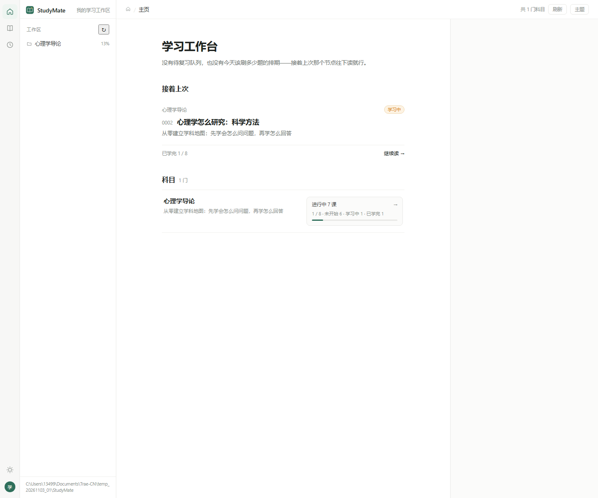
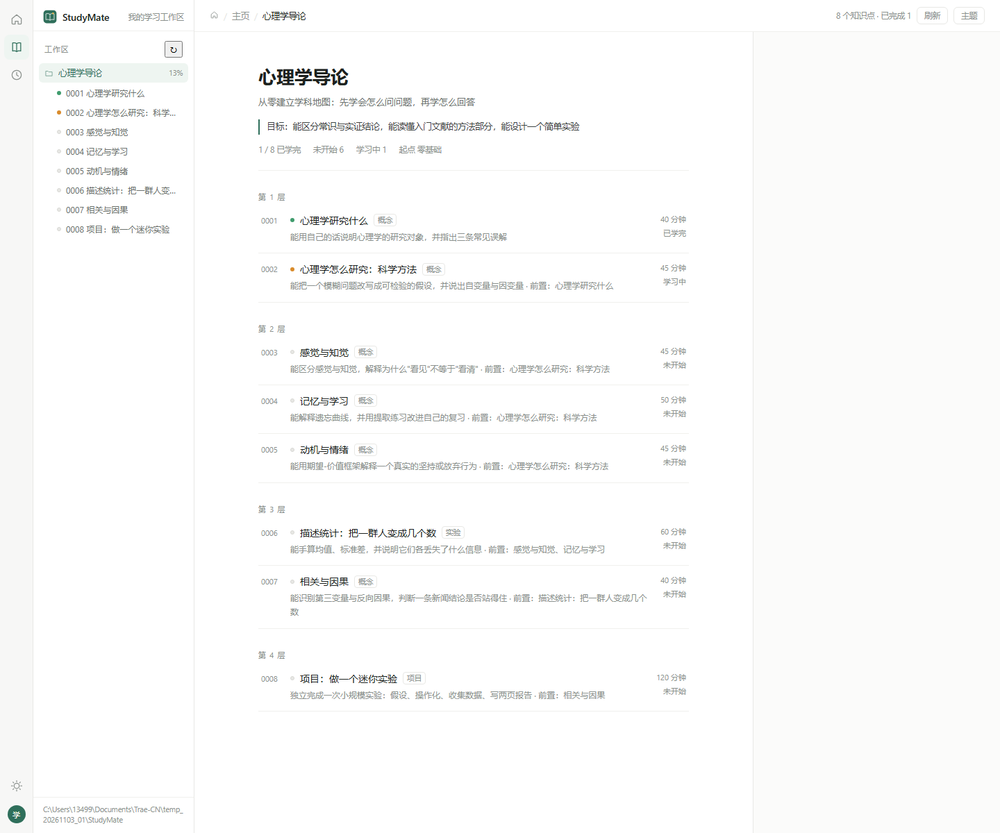
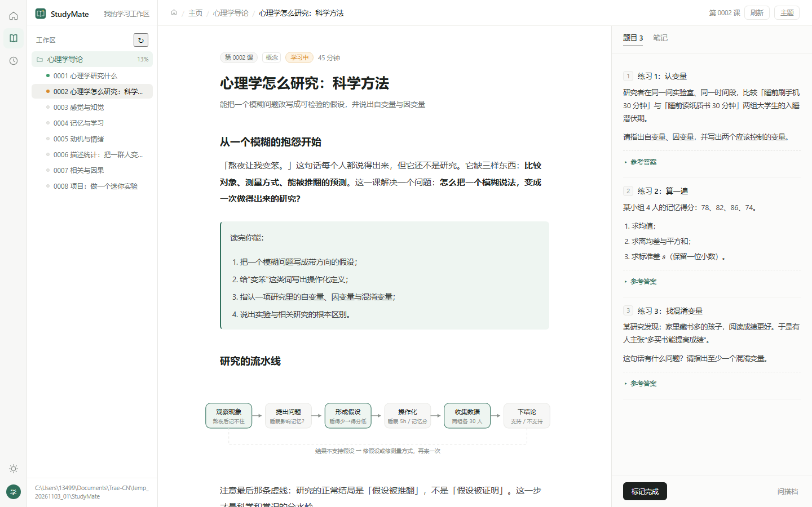

# 学习搭档 · Study Mate for Trae CN

把任意一门科目真正学透的本地学习系统：**入学评估 → 大纲路线图 → 一课一课件 → 练习与项目 → 评估记录 → 跨科目记忆**，自带离线可用的课件阅读端，并在 Trae CN 左侧活动栏里有一个「学习」入口。

灵感来自 [StudyMate](https://github.com/Miaotofu01/Study-Mate)，但原版依赖 DeepSeek Harness 的插件运行时，Trae CN 跑不起来。这一版按 Trae CN 实际支持的能力重新实现：

| 能力 | 原版 StudyMate | 这一版 |
| --- | --- | --- |
| 学习工作流 / 课型 / 记忆 | DSH 预设 + 原生工具 | Trae 技能 + 工作区文件（`SKILL.md`） |
| 课件阅读端 | DSH 客户端面板 | 本地 Node 服务 + 独立网页（离线可用） |
| 左侧工具栏入口 | 宿主提供 | VS Code 扩展：活动栏「学习搭档」内嵌同一个阅读端 |



---

## 功能一览

### 对话侧（在 Trae 里直接说话）

| 你说 | 它做什么 |
| --- | --- |
| 「我想学 C 语言，零基础」 | 用 ≤4 个问题做入学评估 → 排出分层路线图（前置依赖、时长、验收标准）→ 写出第一课课件 |
| 「继续学习」 | 找到路线图里的下一个节点，讲一课、写一课，并更新状态 |
| 「考考我」 | 按这一课出题、批改、指出卡点，写一条评估记录 |
| 「这里没懂」 | 只解释卡住的那一段，并把有效的讲法写进记忆，下次自动沿用 |
| 「我学到哪了」 | 汇总完成度、卡点、下一步，不改动任何文件 |
| `/learn` | 一条命令：汇总进度并启动课件阅读端 |

配套规则：`.trae/skills/study-mate/SKILL.md`、`study-mate/skills/study-mate/references/`（工作区数据格式、课型与讲法手册）。

### 阅读端（本地网页 / 左侧栏）

- **学习工作台**：接着上次那个节点、每门科目的完成度与「未开始 / 学习中 / 已学完」计数。
- **科目页**：按前置依赖分层的路线图，每个节点显示编号、类型、时长、状态；点进去就是课件。
- **课件页**：窄栏单列正文，公式（本地 KaTeX）、流程图（内联 SVG）、要点/例子/警示卡；右侧固定「题目 / 笔记」面板。
- **题目面板**：课件里的 `::: exercise` 块会自动抽到右栏，「参考答案」默认折叠，想先做再对。
- **笔记**：写在右栏「笔记」tab，存成 `subjects/<科目>/notes/<节点>.md`。
- **进度**：开始学习 / 标记完成 / 撤销完成，直接写回 `course.json`，并追加一条 `progress.json`。
- **学习记忆**：`memory/profile.md`、`preferences.md` 的只读视图，换科目不用重新自我介绍。
- **离线**：Markdown（marked）、公式（KaTeX + 字体）全部放在本地 `vendor/`，断网照用。





---

## 快速开始

需要 **Node 18+**，不需要 `npm install`。

```powershell
git clone https://github.com/<你的账号>/study-mate-trae.git
cd study-mate-trae

# 方式一：直接看示例科目「心理学导论」
node "study-mate/app/server.mjs" --workspace "StudyMate" --open
```

终端会打印地址（默认 `http://127.0.0.1:4310/`）并自动打开浏览器。也可以双击 `start.ps1`。

想看界面但还没装 Trae：上面这一条命令就够了，阅读端是独立网页。

---

## 使用方法

### 1. 在 Trae CN 里开一门新课

1. 用 Trae CN 打开这个项目（项目级技能 `.trae/skills/study-mate/SKILL.md` 已生效）。
2. 在对话里说 **「我想学 XXX」**（可加「零基础 / 有基础 / 只想速成」）。
3. 它先问你不超过 4 个问题，然后给出路线图和第一课。
4. 说「继续学习」往下推；说「考考我」「这里没懂」按需分支。

### 2. 打开阅读端看课件

```powershell
# 看示例工作区
node "study-mate/app/server.mjs" --workspace "StudyMate" --open

# 看自己的学习工作区
node "study-mate/app/server.mjs" --workspace "$env:USERPROFILE\StudyMate" --open

# 指定端口 / 不自动开浏览器
node "study-mate/app/server.mjs" --workspace "StudyMate" --port 8080 --no-open
```

### 3. 装进 Trae CN 左侧活动栏（可选）

```powershell
powershell -ExecutionPolicy Bypass -File .\install.ps1
```

做三件事：

1. 技能复制到 `%USERPROFILE%\.trae-cn\plugins\local\study-mate\0.1.0`（任意项目都能对话调用）；
2. VS Code 扩展复制到 `%USERPROFILE%\.trae-cn\extensions\studymate.study-mate-view-0.1.0`（左侧活动栏入口，自动拉起阅读端）；
3. 首次安装把示例工作区放到 `%USERPROFILE%\StudyMate`（已存在则不动）。

装完**完全退出 Trae CN 再打开**，左侧活动栏出现「学习搭档」图标；没出现就在命令面板执行 `Developer: Reload Window`。视图标题栏还有「在浏览器中打开」和「重启服务」。

### 4. 日常学习循环

```
选节点 → 读课件（左） → 做右栏题目 → 对答案 / 记笔记 → 标记完成 → 下一个节点
                                        ↘ 卡住就去对话里说「这里没懂」
```

---

## 数据都在你自己的磁盘上

```
StudyMate/                          # 学习工作区（可随意改名、备份、换机器带着走）
├── workspace.json                  # 科目索引
├── memory/
│   ├── profile.md                  # 你的水平、目标、可投入时间
│   └── preferences.md              # 哪种讲法有效、容易卡在哪
└── subjects/psychology-intro/
    ├── course.json                 # 大纲、节点、状态、前置依赖
    ├── progress.json               # 只追加的状态流水
    ├── lessons/01-xxx.md           # 课件（带 YAML 头）
    ├── notes/<节点>.md             # 你的笔记
    └── records/<节点>.md           # 练习评估记录
```

全部是纯文本，可以直接 git 管理、搜索、手改。课件里支持三类写法：`::: goal/key/warn/note/example/exercise/answer/project/selfcheck` 容器块、`$\bar{x}$` 公式、内联 `<svg class="diagram">` 流程图。

---

## 目录结构

```
.
├── start.ps1                     # 一键启动阅读端
├── install.ps1                   # 安装成 Trae 插件 + 左侧栏扩展
├── .trae/
│   ├── skills/study-mate/SKILL.md   # 项目级技能
│   └── commands/learn.md            # /learn 命令
├── .agents/skills/study-mate/SKILL.md  # 兼容其它技能目录约定
├── study-mate/                   # 插件本体（可复制、可分享）
│   ├── .trae-plugin/plugin.json  # AI 插件清单
│   ├── assets/icon.svg
│   ├── skills/study-mate/        # SKILL.md + references
│   ├── app/                      # 阅读端（server.mjs + public/）
│   └── extension/                # 左侧工具栏扩展（webview 视图）
├── StudyMate/                    # 示例学习工作区
└── docs/screenshots/             # README 用的界面截图
```

---

## 常见问题

**页面打不开 / 端口被占用**
服务会自动从 4310 往后找可用端口，以终端打印的地址为准；想固定端口用 `--port 8080`。

**课件页提示「这一课的课件还没写」**
设计如此：讲一课写一课。回对话里说「继续学习」，搭档会补上这一课。

**公式 / 流程图没有渲染**
检查 `study-mate/app/public/vendor/` 下是否有 `katex.min.js`、`auto-render.min.js`、`katex.min.css` 与 `fonts/`。

**左侧活动栏没有「学习」图标**
`.trae-plugin/plugin.json` 只支持技能与连接器，没有自定义视图容器；所以图标来自 `study-mate/extension`（一个最小 VS Code 扩展：活动栏图标 + webview，内部挂载本地阅读端）。装完要完全重启 Trae CN，或执行 `Developer: Reload Window`。

**Windows 下 PowerShell 脚本报「Unexpected token」**
`install.ps1` / `start.ps1` 必须保存为 UTF-8 **带 BOM**，重新用 `UTF8Encoding($true)` 写回即可。

---

## License

MIT
